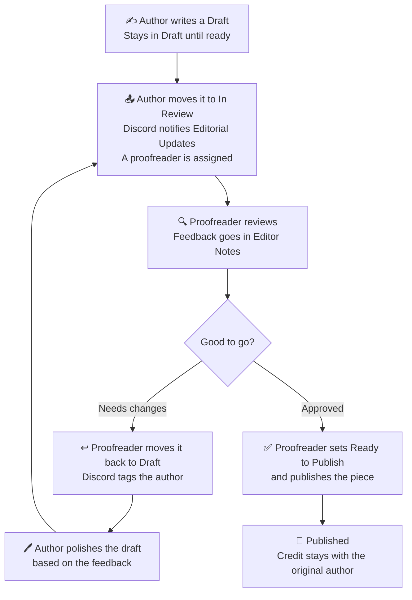

## Roles

**Writers** draft and revise their own pieces.**Proofreaders** review pieces, leave notes, and publish approved work.**Moderators** settle disagreements and handle rule breaks.

Writers don't edit Editor Notes, and proofreaders don't edit a writer's story body. Feedback and writing stay separate.

## Authorship

* Submit only your own work.
* Credit any quotes, sources, or inspirations.
* Every piece carries its author's name, even after edits.
* You keep ownership of your writing. By publishing here, you let us display it on the blog.

## Review Process
1. **Draft.** The writer creates an entry in the CMS.
2. **In Review.** When finished, the writer sets the status to In Review.
3. **Feedback.** A proofreader leaves notes in Editor Notes.
4. **Revise.** The writer updates the piece based on the notes.
5. **Ready to Publish.** When approved, the proofreader sets the status and publishes.
6. **Author Notes.** Writer may inform the proofreader ahead that a certain phrase or word should be kept as a stylistic choice, the proofreader can skip or suggest a close to similar but only to the Author's discretion.

## Review Process Flow
This is how the review process work.

## Disagreements
 
If a writer and proofreader disagree, talk it out first, politely, in `#editorial-updates`. If that doesn't settle it, a moderator decides. Their decision is final for that piece.
 

## Use of AI
Ideally we want our writings to be free from AI as we encourage to use our imagination but we also recognize that times are changing and we need to adapt. It is decided that we can use AI  strictly for brainstorming only and with the following reservations: 

- Your piece must be your own writing. Don't submit AI-generated text as your work.
- Tools for spelling, grammar, or brainstorming are fine.
- If AI played a meaningful role beyond that, tell the proofreaders when you submit.
## Conduct
 
Be respectful in feedback, comments, and on our Discord server. Harassment, plagiarism, and hate speech aren't tolerated. Moderators may unpublish a piece or remove an author who breaks these guidelines.

 ## Staying Active

Writers are expected to publish at least one piece every 3 months. If you go longer without publishing, a moderator will check in with you first. Membership may be deactivated if there's no response or update.

Need a break? Let a moderator know ahead of time and your spot stays safe.

---
 
*We may update these guidelines as the blog grows. Changes will be announced in the Discord server.*
